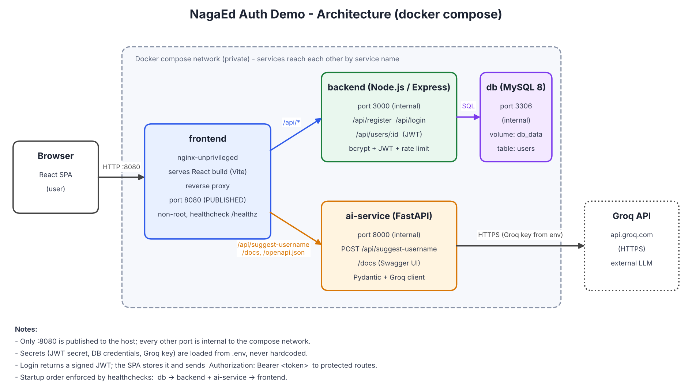

# NagaEd Hurdle Task – Software Developer

**Candidate:** Nitesh Kumar Das
**Email:** `<your-email>` · **Phone:** `<your-phone>` · **GitHub:** `<your-github-url>`

A small full-stack feature: user registration & authentication with a React UI, a Node.js REST API, a FastAPI AI microservice (Groq) and a Docker Compose setup that runs everything.



(`architecture.png` / `architecture.pdf` are in the repo root.)

## Quick start (Docker)

Requirements: Docker + Docker Compose v2.

```bash
cp .env.example .env          # then (optionally) set GROQ_API_KEY and a real JWT_SECRET
docker compose up --build
```

Open **http://localhost:8080**

| URL | What |
|---|---|
| http://localhost:8080 | React app (Register / Login / Dashboard) |
| http://localhost:8080/api/... | Node.js API (proxied by nginx) |
| http://localhost:8080/docs | FastAPI Swagger UI (proxied by nginx) |

* `GROQ_API_KEY` is free from <https://console.groq.com> (no card). If it is left empty the stack still starts; only `POST /api/suggest-username` answers `503 AI_NOT_CONFIGURED`.
* Generate a strong JWT secret with `openssl rand -hex 32` (must be ≥ 32 chars).
* Only port **8080** is published to the host. MySQL (3306), the Node API (3000) and FastAPI (8000) are reachable only on the private compose network, by service name (`db`, `backend`, `ai-service`).
* Startup order is enforced with health checks: `db → backend + ai-service → frontend`.
* Reset all data: `docker compose down -v`.

## Repository layout

```
backend/      Node.js (Express) REST API    – routes → controllers → services → repositories → MySQL
frontend/     React (Vite) SPA + nginx      – pages, components, context, services (API layer)
ai-service/   FastAPI microservice          – /api/suggest-username via Groq
db/schema.sql users table (also auto-created by the API; idempotent)
docker-compose.yml, .env.example, architecture.png|pdf
```

## Task 1 – Node.js API (`backend/`)

| Method & path | Auth | Description |
|---|---|---|
| `POST /api/register` | – | `{ username, email, password, address }` → `201 { user }` |
| `POST /api/login` | – | `{ email, password }` → `200 { token, tokenType, user }` |
| `GET /api/users/:id` | Bearer JWT | → `200 { user }` (never includes the password hash) |
| `GET /health` | – | liveness + DB check (used by Docker) |

Errors always look like `{ "error": { "code", "message", "details?" } }`:
`400` bad JSON/id · `401` missing/invalid/expired token or bad credentials · `403` token belongs to another user · `404` · `409` `Email already in use` / `Username already taken` · `422` field validation (`details: [{field, message}]`) · `429` rate limited.

**Validation:** username 3–30 chars (`A–Z a–z 0–9 . _ -`), valid email (lower-cased), password 8–72 bytes with a letter and a number, address 5–255 chars. Non-string values (e.g. `{"email": {"$ne": null}}`) are rejected.

**Security notes**
* Passwords hashed with bcrypt (`bcryptjs`, 12 rounds) – never stored, logged or returned.
* All SQL uses parameterised queries (`mysql2` `execute`), so no string-built SQL.
* JWT: HS256 pinned on verify (blocks `alg:none`), 1 h expiry, secret from env (app refuses to start without ≥ 32 chars).
* `GET /api/users/:id` only returns the **caller's own** record (`403` otherwise) – a valid token alone isn't enough to read other users (IDOR protection).
* Login does a dummy bcrypt compare for unknown emails (reduces user-enumeration timing signal) and returns the same `Invalid credentials` message either way.
* `helmet`, 10 kB body limit, rate limiting on register/login, generic 500 messages (details only in server logs).

Run locally without Docker:

```bash
cd backend && npm install
export JWT_SECRET=$(openssl rand -hex 32) DB_HOST=localhost DB_USER=... DB_PASSWORD=... DB_NAME=...
npm start          # needs a reachable MySQL 8
npm test           # unit tests for validators (no DB needed)
```

## Task 2 – React frontend (`frontend/`)

* Views: **Register**, **Login**, **Dashboard** (shows `Welcome, <username>`; it re-fetches the profile from the protected endpoint, and logs out if the token is rejected).
* `src/services/api.js` is the only place that calls `fetch`; `AuthContext` owns the JWT (localStorage); `useAsyncAction` gives every form loading + error state.
* API errors are displayed (e.g. “Email already in use”, “Invalid credentials”); field-level `details` from `422` responses appear under the matching input.
* Bonus: on the Register page, enter interests and click **Suggest** to get 3 AI usernames from the FastAPI service; click one to fill the username field.
* No secrets in the bundle. API base URL is relative (`/api`), overridable with `VITE_API_BASE_URL`.

Dev mode: `cd frontend && npm install && npm run dev` (Vite proxies `/api` → `localhost:3000`, and `/api/suggest-username` → `localhost:8000`).

## Task 3 – FastAPI AI service (`ai-service/`)

`POST /api/suggest-username`

```json
// request                                   // response
{ "interests": ["astronomy", "jazz"] }       { "suggestions": ["StarJazz", "NebulaNotes", "CosmicCadence"] }
```

* Pydantic models validate input (1–10 interests, each 1–50 chars, unknown fields rejected) and output (exactly 3 strings).
* Groq is called through its OpenAI-compatible endpoint (`llama-3.1-8b-instant` by default, override with `GROQ_MODEL`) with `response_format: json_object`.
* **Prompt:** a short system prompt fixes the rules (3 different, 3–20 chars, allowed characters, original, no brands/real people), demands a strict JSON shape, and tells the model to treat the interests as untrusted data (prompt-injection hardening). Interests are flattened to single plain lines before being sent.
* The model output is parsed and **re-validated server-side** (cleaned, de-duplicated case-insensitively, length-checked); fewer than 3 usable names → error rather than a bad response.
* Errors (same shape as the Node API): `422` malformed input · `502` Groq failed / unusable output · `503` key not configured · `504` Groq timeout (15 s).
* `/docs` (Swagger) and `/redoc` work out of the box. `GROQ_API_KEY` is read from the environment only.

Run locally: `cd ai-service && pip install -r requirements.txt && GROQ_API_KEY=... uvicorn app.main:app --reload`
Tests: `python -m unittest discover -s tests -t .` (pure parsing logic).

## Task 4 – Docker Compose

* `backend/Dockerfile`, `ai-service/Dockerfile`, `frontend/Dockerfile` – all **multi-stage**, each service has a `.dockerignore`.
* Containers run **non-root**: `node` user (API), uid 10001 (FastAPI), `nginx-unprivileged` (web). The official MySQL image drops privileges to `mysql` itself.
* All config comes from `.env` (JWT secret, Groq key, DB credentials). Nothing is hardcoded in Dockerfiles or the compose file; required values use `${VAR:?error}` so a missing one fails fast with a clear message.
* Services talk by service name; nginx routes `/api/suggest-username`, `/docs`, `/openapi.json` → `ai-service:8000` and the rest of `/api/*` → `backend:3000`.
* Health checks on all four services; `depends_on: condition: service_healthy` for ordering.
* Quick smoke test after `docker compose up`:

```bash
curl -s localhost:8080/api/register -H 'content-type: application/json' \
  -d '{"username":"demo_user","email":"demo@example.com","password":"Passw0rd123","address":"1 Main Street"}'
TOKEN=$(curl -s localhost:8080/api/login -H 'content-type: application/json' \
  -d '{"email":"demo@example.com","password":"Passw0rd123"}' | python3 -c 'import sys,json;print(json.load(sys.stdin)["token"])')
curl -s localhost:8080/api/users/1 -H "Authorization: Bearer $TOKEN"
curl -s localhost:8080/api/suggest-username -H 'content-type: application/json' -d '{"interests":["chess","coffee"]}'
```

## Design decisions & trade-offs

* **One public entry point (nginx)** keeps the browser same-origin (no CORS) and exposes the minimum surface. CORS can still be enabled for the Node API via `CORS_ORIGIN`.
* **`bcryptjs`** (pure JS, same bcrypt algorithm) avoids native-build problems in Alpine images.
* **JWT in localStorage** is what the task asks for and is simple; the trade-off is XSS exposure. A production version would use an httpOnly, SameSite cookie (plus CSRF protection) and refresh tokens.
* The API creates the `users` table on startup (idempotent) *and* `db/schema.sql` is mounted into MySQL, so it works with either a fresh compose stack or an existing database. A real project would use a migration tool.
* No lockfiles are committed; run `npm install` once and commit `package-lock.json` for reproducible builds (then switch the Dockerfiles to `npm ci`).

## Known limitations

* Password reset, email verification and refresh tokens are out of scope.
* The Groq integration needs a real key and internet access; without a key the endpoint returns `503` by design.
